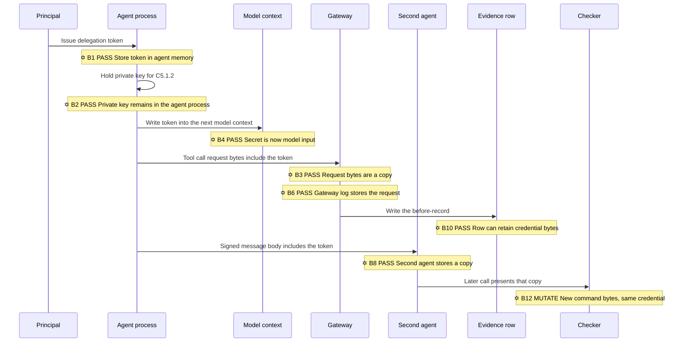
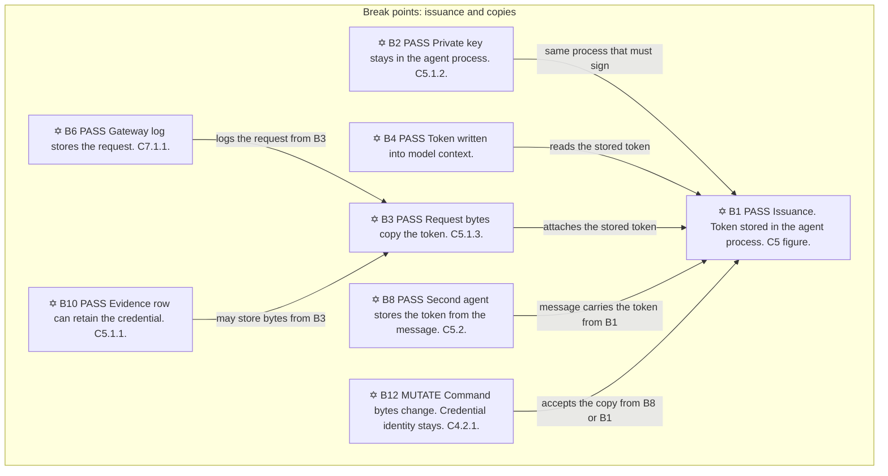
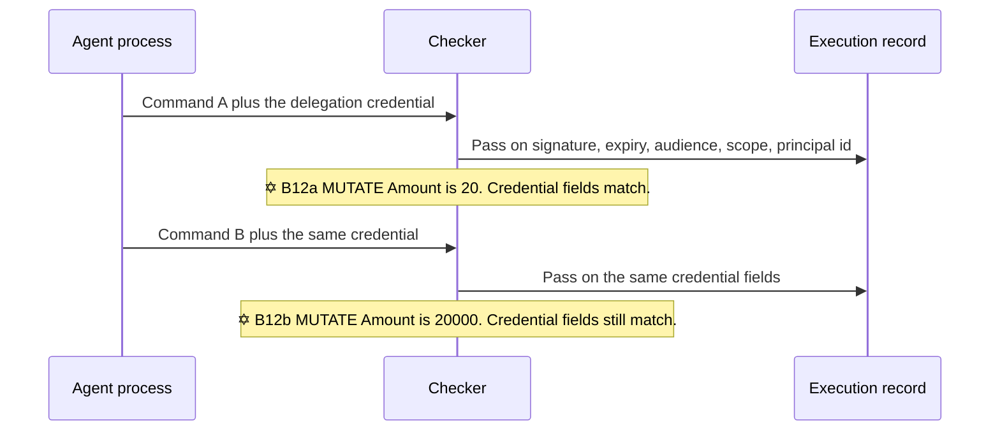
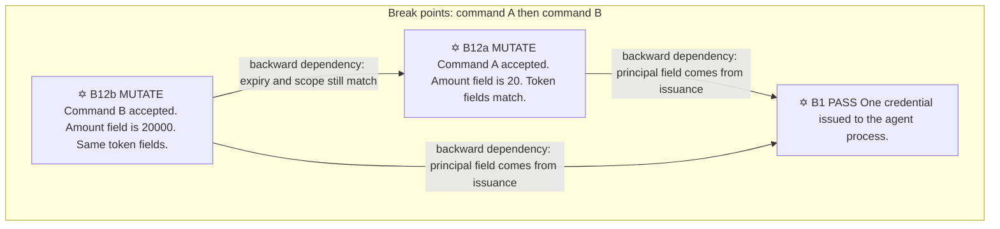
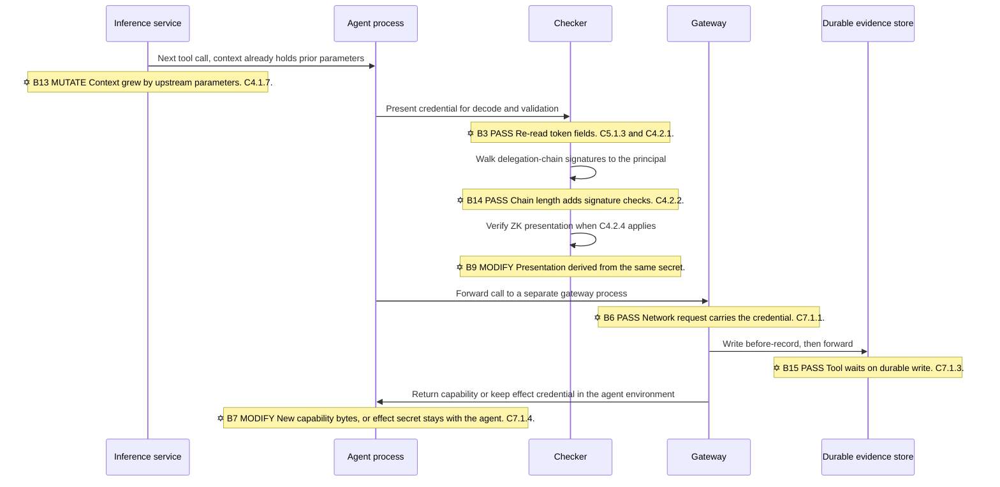
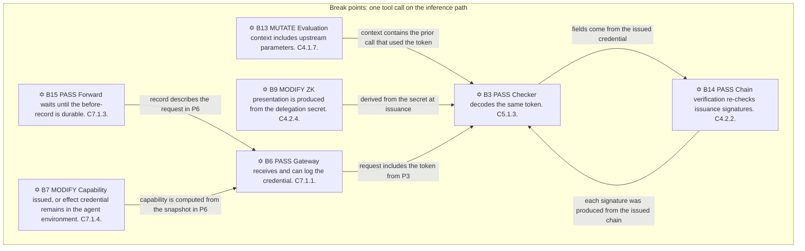
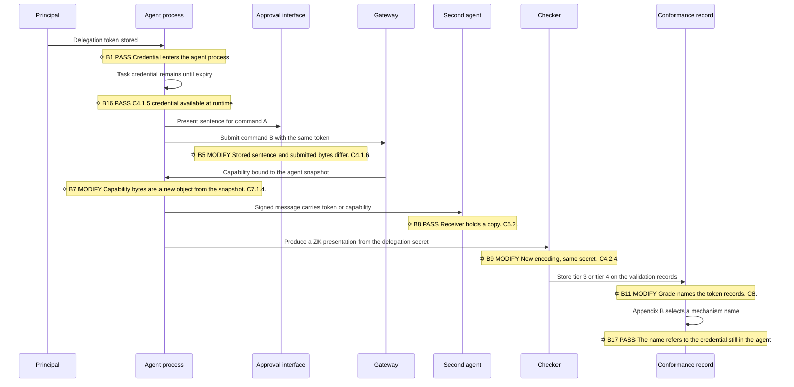
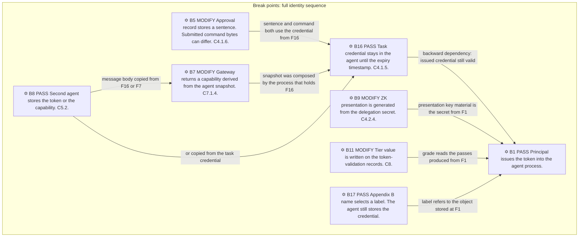

# Review: the draft authorizes presentation of a reusable credential

**Frank Dylan Rosario**  
**Dr. Lin Wang**  
**Dr. Octavia Sulea**

6 November 2026

Plain-language version of the review in [WHITE-PAPER-ACADEMIC-REVIEW.md](WHITE-PAPER-ACADEMIC-REVIEW.md). Informative. The published draft remains the normative text under `0.1/en/`. This file states the same claims. Each example is a definition, a context, the record the requirement stores, and the result of a second command.

## 0. Sentence form

The earlier draft of this review used five sentence forms that name a judgment instead of a field. This version replaces each form with a definition.

| Earlier form | What the sentence was doing | Replacement |
| --- | --- | --- |
| "Keep the example in view" or "watch the promise against the bytes" | Point at one example without defining its fields | **Definition** of the two command strings, then the fields the requirement compares |
| "Room," "door," "wire," "hands," "hop" | Name a storage location or a network request by a spatial word | The location: process memory, model context, request bytes, gateway process, evidence row |
| "Clock," "window," "lifetime" | Name the expiry field by a time image | The expiry timestamp on the credential |
| "Ceremony," "patch," "elegance," "tax," "promise" | Add an evaluation without naming the operation | The operation: validate a signature, write a record, concatenate upstream parameters, flush a record to durable storage |
| A contrast that restates the same fact | Say what a check omits by opposing two images | Two statements: the check input is field F; the command bytes are field G; the requirement text names F |

**Bearer credential.** An object a checker accepts when its signature, expiry, audience, and scope match, regardless of which process stored the copy.

**Per-act proof.** A record that binds the canonical bytes of this command, a fresh nonce, and the anchored checker digest. The ledger marks the nonce spent before the checker returns a decision. The witness remains inside the protected boundary. The next command uses a new nonce.

**One-shot.** The per-act proof applied to each interactive step. The next step uses a new reservation, a new binding, and a new burn.

**Oscillation.** The same per-act proof applied to each direction between two service processes. The reply is a new act.

**Running example.** Command A is the string `pay invoice 1042 for 20 units from account A to account B`. Command B is the string `pay invoice 1042 for 20000 units from account A to account B`. The two strings differ in the amount field. A principal has issued one delegation credential. The credential's scope value includes payments. The credential's expiry timestamp is later than both calls. The agent process stores that credential and attaches it to each call.

**Diagram marks.** A six-pointed star `✡` is a break. The label is `PASS`, `MODIFY`, or `MUTATE`. `PASS` means the credential bytes are copied to another location and the checker still accepts them. `MODIFY` means a new object is derived from the credential and presented later. `MUTATE` means the command bytes or the evaluation context change while the credential identity stays the same. A backward dependency is an arrow from a later break to the earlier break whose stored credential still authorizes the later pass. After each swim lane, the same breaks are repeated as rectangle nodes. The rectangle is the square block around that break.

## Abstract

The Standard defines agent control by the credential it issues. [C5](https://github.com/LFDT-ProofOfControl/ov-poc-standard/blob/main/0.1/en/0x10-C05-Identity.md) states that a principal issues a signed, short-lived, scoped delegation token to the agent, and that every action traces to that principal. The agent process stores the token. Later requirements add checks on that token: expiry, audience, scope, schema, path context, a delegation-chain verification, a separate gateway process, three signed evidence records, and a durable write before the tool runs. Those checks compare token fields. They do not compare a witness binding to the command bytes. Command A and command B both pass while one credential remains inside its expiry. The inference service performs that list of checks on every tool call, and [C4.1.7](https://github.com/LFDT-ProofOfControl/ov-poc-standard/blob/main/0.1/en/0x10-C04-Authorization.md) appends upstream parameters to the next evaluation context, so the context size grows with the number of tool calls. A high-performance network that processes fixed-size messages at a fixed cost per message does not match a per-call cost that grows with chain length, context length, and a durable write. The per-act proof is one binding, one burn, and one decision per command.

## 1. The issued object

**Definition.** A control architecture is the set of objects a checker accepts as authority for a command. In this draft the object is the delegation token defined in C5.

**Context.** The figure caption in [C5 Identity](https://github.com/LFDT-ProofOfControl/ov-poc-standard/blob/main/0.1/en/0x10-C05-Identity.md) states:

> The identity chain: principal issues a signed, short-lived, scoped delegation token to the agent; every action traces back to the principal.

The control objective on the same page asks for evidence of "which agent and which principal ran." The paragraph under C5.1 states:

> Cryptographic principal-to-agent delegation tokens (e.g., short-lived OAuth/JWT, W3C DIDs, or cryptographic capability URLs) explicitly bind agent tool calls back to human intent.

**Record.** The execution record contains the agent identifier, the principal identifier, and the token fields the checker validated: issuer, audience, expiry, and linkage to a grant. C5.1.1 requires those identifiers. The C5.1.3 auditor note tells the auditor to decode the token on a sampled tool call.

**Result.** The token is stored in the agent process because C5.1.3 requires the tool call to carry it and C5.1.2 requires the agent to authenticate with a certificate, a key pair, or a DID. A second call inside the same expiry presents the same token. The checker accepts the second call when signature, expiry, audience, and scope match. The record of the second call names the same principal. The requirement text does not include a witness value bound to the command bytes.

The sentence "explicitly bind agent tool calls back to human intent" names a binding to intent. The specified check compares token fields. The principal identifier is a field in the token. The agent process is the process that stores the token and attaches it to the call. The check result is a match on those fields.

### 1.1 Copies the requirements create

Each requirement names a location where the agent process reads or writes the credential.

**C5.1.2.** Definition: the agent authenticates with a certificate, a key pair, or a DID, and the validation event is recorded. Context: the agent process holds the private key because that process produces the authentication operation. Record: a validation event. If the pipeline stores the credential bytes next to the event, the row contains a second copy. Result: a later reader of the row, including the agent process, can read that copy. Link: [C5.1.2](https://github.com/LFDT-ProofOfControl/ov-poc-standard/blob/main/0.1/en/0x10-C05-Identity.md).

**C5.1.3.** Definition: each tool call carries an OAuth token, a JWT, a verifiable credential, or a capability URL. Context: the request bytes include the token. Record: the decoded issuer, audience, expiry, and grant linkage. Result: the request bytes, a retry buffer, and a gateway log each contain a copy. A checker accepts any copy whose fields match, because the check is on the fields. Link: [C5.1.3](https://github.com/LFDT-ProofOfControl/ov-poc-standard/blob/main/0.1/en/0x10-C05-Identity.md).

**C5.1.4.** Definition: the identity credential is held in an attested enclave or TPM, and a process outside a matching measurement does not exercise it. Context: the agent process runs inside a matching measurement and presents the key. Record: the measurement result and the presentation. Result: that process can write the presentation into the model context that is sent on the next turn. The measurement compares platform state to a reference. It does not mark a nonce spent for these command bytes. Link: [C5.1.4](https://github.com/LFDT-ProofOfControl/ov-poc-standard/blob/main/0.1/en/0x10-C05-Identity.md).

**C5.2.1 and C5.2.2.** Definition: the sending agent signs messages with its credential. The receiver validates the signature with published key material and does not contact the sender's operator. Context: the private key remains in the sending agent process. The message body can include the delegation token. Record: the sender key identifier and the signature result. Result: the receiving agent stores a copy of the token and can attach that copy to a later call. Link: [C5.2](https://github.com/LFDT-ProofOfControl/ov-poc-standard/blob/main/0.1/en/0x10-C05-Identity.md).

**Locations available to the agent process.** The process can assign the token to a variable used by the next tool call. It can write the token into a debug log. It can insert the token into the model context for the next turn. It can place the token in a tool-result field that the model receives. It can write the token to a workspace file, a memory record, or a retrieval store. It can display a session derived from the token on an approval interface the agent process renders. It can place the token in a signed message to a second agent. It can read the token back from an evidence row that stored it. These are write and read operations on an object C5 requires the agent to store and to present.

The swim lane is the order of those writes. Each star is a location where the credential is passed, modified, or accepted again.

Square blocks for this sequence. Each rectangle is one break. The arrow is the backward dependency: the later pass still uses the credential stored at B1.

### 1.2 The threat table's scope lines

**Definition.** [THREATS.md](https://github.com/LFDT-ProofOfControl/ov-poc-standard/blob/main/docs/use-cases/THREATS.md) gives each threat a description, a statement of what Proof-of-Control addresses, and an out-of-scope line.

**Context.** `identity-abuse` is "an agent claims authority it was not granted." The addressed column is "cryptographic identity" and binding "every action to a principal." The out-of-scope line is "credential theft or social engineering at the human level." `prompt-injection` is "crafted input redirects the agent's objective." The out-of-scope line is "the injection itself." `system-prompt-leakage` is "the agent discloses its own instructions," and the addressed column is "Not addressed."

**Record.** A conformant identity record contains a validated token and a principal identifier.

**Result.** The agent process already stores the token under C5.1.3, so a redirected objective uses that stored token. A second process that receives a copy of the token presents the same fields. The out-of-scope line places theft outside the identity chapter. The issuance requirement places the token inside the agent process before any theft.

### 1.3 Command A and command B

**Definition.** Command A is `pay invoice 1042 for 20 units from account A to account B`. Command B is `pay invoice 1042 for 20000 units from account A to account B`. One delegation credential is attached to both calls. Its scope includes payments. Its expiry timestamp is later than both calls.

**Context.** [C4.2.1](https://github.com/LFDT-ProofOfControl/ov-poc-standard/blob/main/0.1/en/0x10-C04-Authorization.md) states: "each action's signed authorization token is cryptographically validated (signature, expiry, audience, scope) before execution, and that validation results are recorded." [C5.1.1](https://github.com/LFDT-ProofOfControl/ov-poc-standard/blob/main/0.1/en/0x10-C05-Identity.md) requires the execution record to carry the agent identifier and the principal identifier.

**Record.** Each call stores a validation result for the same token fields and the same principal identifier. The amount field differs between command A and command B. The requirement text does not include that amount field in the token validation.

**Result.** Both calls pass. The figure caption's statement that every action traces to the principal holds for both records, because both records contain the principal identifier from the token. The records do not contain a witness binding to command A's bytes or to command B's bytes.

### 1.4 C4 states an action binding and specifies a credential

**Definition.** The opening paragraph of [C4](https://github.com/LFDT-ProofOfControl/ov-poc-standard/blob/main/0.1/en/0x10-C04-Authorization.md) states:

> Authority is scoped to the action, not to the actor: permission tied to the specific operation, its configuration, and its limits at the time it acts cannot be replayed against a different action.

**Context.** [C4.1.5](https://github.com/LFDT-ProofOfControl/ov-poc-standard/blob/main/0.1/en/0x10-C04-Authorization.md) states: "agent credentials are issued per task with scope and expiry bound to that task (e.g., short-lived tokens), and that no standing broad-scope credential is available to the agent at runtime." The agent process stores the per-task credential. Command A and command B are different command strings. They share the credential when the scope value covers both.

**Record.** The execution record contains the credential identifier, the scope, and the expiry. `excessive-agency` in [THREATS.md](https://github.com/LFDT-ProofOfControl/ov-poc-standard/blob/main/docs/use-cases/THREATS.md) says the out-of-scope item is "whether the grant was too broad."

**Result.** C4.1.5 removes a broad credential by issuing a task credential into the agent process. The checker accepts a later command when the scope string matches. The scope string is the field that decides whether command B is the same task as command A. The requirement does not bind a witness to either command string.

### 1.5 Additional checks on the same credential, and the cost on the inference path

**Definition.** An additional check is a comparison or a write the draft requires before a tool runs. The credential presented on the call remains the authority object.

**Context.** The introduction states, under "Industry-led," that "the strongest verification is usually the most expensive" and that "the gain in trustworthiness at the top comes with a real jump in cost" ([introduction](https://github.com/LFDT-ProofOfControl/ov-poc-standard/blob/main/docs/introduction.md)). Under "Speed" it states that "the risk here is arriving late, not arriving imperfect." Those sentences describe the standards schedule and the adopter's cost. The runtime cost is the list below, which runs while the model waits for the tool.

**Record.** One tool call, if the listed requirements are implemented, produces these operations:

1. Decode issuer, audience, expiry, and grant linkage from the token on the call ([C5.1.3](https://github.com/LFDT-ProofOfControl/ov-poc-standard/blob/main/0.1/en/0x10-C05-Identity.md) auditor note).
2. Record a credential-validation event ([C5.1.2](https://github.com/LFDT-ProofOfControl/ov-poc-standard/blob/main/0.1/en/0x10-C05-Identity.md)).
3. When the deployment claims C5.1.4, compare an enclave or TPM measurement to a reference.
4. Evaluate the action against the permission set and store the matched permission ([C4.1.2](https://github.com/LFDT-ProofOfControl/ov-poc-standard/blob/main/0.1/en/0x10-C04-Authorization.md)).
5. Validate parameters against a schema and store a parameter digest ([C4.1.4](https://github.com/LFDT-ProofOfControl/ov-poc-standard/blob/main/0.1/en/0x10-C04-Authorization.md)).
6. Include "parameters and state carried from upstream invocations" in the next evaluation context ([C4.1.7](https://github.com/LFDT-ProofOfControl/ov-poc-standard/blob/main/0.1/en/0x10-C04-Authorization.md)). The context size increases with each upstream call.
7. Validate each delegation-chain signature back to the originating principal ([C4.2.2](https://github.com/LFDT-ProofOfControl/ov-poc-standard/blob/main/0.1/en/0x10-C04-Authorization.md)). The number of signature checks equals the number of hops in the chain.
8. When C4.2.4 applies, verify a zero-knowledge credential presentation.
9. Send the call to an Action Interception Gateway that is "a separate process or service from the agent" ([C7.1.1](https://github.com/LFDT-ProofOfControl/ov-poc-standard/blob/main/0.1/en/0x10-C07-Evidence-Generation-and-Properties.md)). That is one network request to another process.
10. Write three evidence records — before, during, and after — each independently signed ([C7.1.2](https://github.com/LFDT-ProofOfControl/ov-poc-standard/blob/main/0.1/en/0x10-C07-Evidence-Generation-and-Properties.md)).
11. Write the before-record to durable storage before forwarding. C7.1.3 states: "the gateway does not forward the action to the tool until the before record is durably written."
12. Release a single-use capability bound to the snapshot digest, or hold the effect credentials in the attested environment with the agent ([C7.1.4](https://github.com/LFDT-ProofOfControl/ov-poc-standard/blob/main/0.1/en/0x10-C07-Evidence-Generation-and-Properties.md)).

**Result.** Operations 1 through 8 compare or store fields of the same credential and of the call that carries it. Operations 9 through 11 add network and storage latency before the tool runs. Operation 6 places upstream parameters, and operation 1 places the token, into data the inference service processes. The model context therefore contains the token, which is a secret, together with the prompt. Context length increases as tool calls are appended. [C8](https://github.com/LFDT-ProofOfControl/ov-poc-standard/blob/main/0.1/en/0x10-C08-Verifiability-Tiers.md) states: "The evidence base is five self-authored deployment descriptions and no real-world system."

The swim lane is one tool call while the model waits. Stars mark where the credential is passed or where the evaluation context is changed. The checker returns a pass on the same credential at the end.

**High-performance network.** Definition: a network that forwards messages of a stated size and spends a stated number of operations per message. Context: an inference service on that network runs a tool call while the model waits. A per-act proof does a fixed sequence: bind the command bytes, mark one nonce spent, return one decision. The draft's list above adds signature checks proportional to chain length, context proportional to the number of prior tool calls, and a durable write before forward. Result: the per-call operation count is not fixed. Command A and command B still both pass, because the added operations validate the same credential.

The closing statement of this section is the definition of the failure. Authority is presentation of a credential the agent process stores. Later requirements add comparisons and writes on that credential. They do not replace the credential with a witness binding to the command bytes. Command A and command B both receive a pass inside one expiry.

## 2. Each requirement name, the storage location, and the copy

The credential bytes stay the same. The requirement name changes. Each subsection uses the same four labels.

### 2.1 Delegation token

**Definition.** The object in C5.1.3: an OAuth token, a JWT, a verifiable credential, or a capability URL issued for the principal [8].

**Context.** The agent process is the client that must attach this object to the tool call. It is stored in process memory, in the runtime configuration, or in a secret store the process is permitted to read.

**Record.** The call contains the token. A debug log, the next model context, or a tool-result field can contain another copy if the process writes it there.

**Result.** A checker accepts the original and the copy until the expiry timestamp, because acceptance compares token fields.

### 2.2 Credential and private key

**Definition.** The certificate, key pair, or DID in C5.1.2 [8].

**Context.** The agent process produces the signature, so the process can read the private key.

**Record.** The validation log records the presentation. If credential bytes are stored in that log, the log is a copy of the secret.

**Result.** A reader of the log, including the agent, obtains the stored bytes.

### 2.3 Attested environment

**Definition.** C5.1.4 places the key in an enclave or TPM and rejects use from a non-matching measurement [8].

**Context.** The agent process inside a matching measurement presents the key.

**Record.** The measurement result and the presentation.

**Result.** The process can copy the presentation into the model context or onto the next tool call. The measurement comparison does not mark a command nonce spent.

### 2.4 Per-task credential

**Definition.** The credential C4.1.5 issues for a task, with a scope and an expiry [6].

**Context.** The agent process stores it for the interval before the expiry timestamp. Command A and command B can both occur in that interval.

**Record.** A context entry, a memory write, a retrieval record, or a workspace file can store a copy. `memory-poisoning` in [9] addresses provenance of memory writes. The out-of-scope line is "a validly sourced but misleading note." A copy of the task credential written by the agent is a validly sourced note.

**Result.** A later tool call reads that copy and presents it.

### 2.5 Authorization token on the request

**Definition.** The token C4.2.1 validates and C5.1.3 requires on the call [6] [8].

**Context.** The request bytes include the token. A proxy, a gateway log, a retry buffer, and the tool's receipt each store those bytes.

**Record.** Signature result, audience, scope, and expiry.

**Result.** A retry before expiry resubmits the same bytes. Command A, stored in a log with its token, can be submitted again from the log. The expiry field is a timestamp. It is not a spent-nonce record.

### 2.6 Approval record

**Definition.** C4.1.6 stores the approver's identity, the content presented, the decision, and a timestamp [6].

**Context.** The agent process renders the presented content and submits the tool-call bytes. It can present the sentence "pay invoice 1042 for 20 units" and submit command B with the same delegation token. If the approval interface is in the agent process, the process can also store the approver session.

**Record.** The four C4.1.6 fields. `approval-fatigue` in [9] addresses "the raw, true intent presented for approval, and the approval decisions." The out-of-scope line is "the human fatigue and social engineering itself."

**Result.** The stored sentence and the submitted command bytes are separate strings. The requirement records the sentence. It does not require those strings to be equal.

### 2.7 Single-use capability

**Definition.** C7.1.4 option (b) releases a capability bound to a snapshot digest and a target resource [7]. Option (a) holds effect credentials in the attested environment that emits the request.

**Context.** The agent process composed the snapshot. The capability is returned to the caller or included in the call. Before a checker marks it spent, the process can write it to memory, a retry buffer, a second tool call, or a message.

**Record.** The snapshot digest, the target, and the capability.

**Result.** The single-use condition is a check at acceptance time. Until that check marks the value spent, the agent process holds the bytes. Under option (a), the effect credential and the agent process are in the same execution environment, so a write from that process is a copy of the effect credential.

### 2.8 Message to a second agent

**Definition.** C5.2.1 and C5.2.2, plus the delegation-chain check in C4.2.2 [8] [6].

**Context.** The sending process signs with its private key. The message body can include the delegation token, the task credential, or the capability. The receiving process stores the message.

**Record.** Sender key identifier, signature result, and any token bytes in the body. `insecure-inter-agent-comms` in [9] addresses forged or unsigned messages. A valid signature on a message that contains a token is a verified signature.

**Result.** The receiving process can attach the token to its own later call.

### 2.9 Zero-knowledge presentation

**Definition.** C4.2.4: the relying party receives a proof of policy-compliant delegation and validates it without receiving the full chain [6].

**Context.** The agent process produces the presentation from the delegation secret. It can store the presentation and produce another presentation from the same secret.

**Record.** The presentation artifact and the verifier result.

**Result.** The encoding differs from the raw token. The producing process still holds the secret that generates a new presentation.

### 2.10 Execution record

**Definition.** C5.1.1 requires agent identifier and principal identifier. C2.4.1 requires minimized forms of protected data [8] [13].

**Context.** If the pipeline stores the token, the credential configuration, or the capability in the row, the row contains those bytes. The agent process that can read the row can read the bytes. `data-exfiltration` in [9] addresses unauthorized egress. An in-scope call is a call whose token scope matches. The agent can place the token on an in-scope call that sends data to another system. `system-prompt-leakage` is marked "Not addressed." The system prompt and the token can both be fields in the model context.

**Record.** Identifiers, and any credential bytes the pipeline retained.

**Result.** A reader of the row obtains the retained bytes.

### 2.11 Tier label

**Definition.** C8 assigns Proof-of-Control to Tier 3 or Tier 4 [10].

**Context.** The tier is applied to the evidence records produced above.

**Record.** The tier value and the underlying token-validation records.

**Result.** The tier value names a grade of those records. The records contain the credential presentations.

### 2.12 Appendix B labels

**Definition.** Appendix B lists signatures, verifiable credentials, remote attestation, commitments, and zero-knowledge proofs as mechanism names [1].

**Context.** An assessor selects one name for the delegation token.

**Record.** The selected mechanism name.

**Result.** The agent process still stores the credential the name refers to.

The swim lane below is the full rename sequence from section 2. Stars mark each pass, modification, or mutation. The square blocks repeat that sequence. Backward arrows point at the earlier credential the later object still depends on.

## 3. One set of credential bytes

**Definition.** The private key, the bearer credential, the session written after a successful check, the capability URL, the approval decision, the snapshot capability, and each copy written into model context, memory, a tool argument, a peer message, or an evidence row.

**Context.** C5.1.3 places the token on the outbound call [8]. C4.1.5 leaves the task credential in the runtime [6]. C7.1.1 routes the call through a gateway process [7]. The gateway log stores the request bytes. C7.1.4 returns a capability or keeps the effect credential in the agent process's execution environment [7].

**Record.** Each of those locations can contain the credential bytes or a presentation derived from them.

**Result.** The output of one requirement is the input of the next, and the agent process can read and write at each step. C7.3.2 assigns evidence-signing keys to the gateway and states that operator and agent identities do not hold those keys [7]. That assignment covers the log-signing key. It does not remove the delegation token, the agent private key, the task credential, or the capability from the agent process. A log signed by the gateway key is a signed record of credentials the agent can still present. If the row contains those credentials, the agent can read them.

The threat rows match this storage. `identity-abuse` leaves credential theft out of scope [9]. `excessive-agency` leaves grant breadth out of scope [9]. `prompt-injection` leaves the injection out of scope [9]. The credential is already in the process under C5.1.3.

## 4. Additional requirements, same credential

Each additional requirement can be implemented as written. The credential remains presentable. Each one also adds a storage location.

**Expiry and scope.** Definition: C5 and C4.1.5 attach an expiry timestamp and a scope string [8] [6]. Context: command A occurs at 10:01 and command B at 10:04. The expiry timestamp is 10:15. The scope string includes payments. The agent writes the token into a retry buffer at 10:02. Record: two validation passes and one retry copy. Result: the 10:09 retry matches signature, audience, and scope. The expiry timestamp does not record that a nonce was spent.

**Approval record.** Definition: the four fields in C4.1.6 [6]. Context: the presented sentence is command A's text. The submitted tool call is command B. Both are stored. Record: the sentence, the decision, and the token on command B. Result: the requirement does not state that the sentence bytes equal the tool-call bytes.

**Gateway.** Definition: C7.1.1 adds a separate process. C7.1.3 writes a before-record, then forwards. C7.1.4 can issue a capability [7]. Context: the token is included in the request the gateway receives. Record: the gateway log, the before-record, and the capability bytes. Result: until a checker marks the capability spent, the caller can place it in a second request or in a message.

**Attestation.** Definition: C5.1.4 [8]. Context: the key is stored in an enclave or TPM. The agent process in that environment writes logs, model context, and tool arguments. Record: the measurement and any presentation the process writes. Result: the presentation can be copied into a request. The measurement does not spend a command nonce.

**Path context.** Definition: C4.1.7 appends upstream parameters to the next evaluation. C4.1.8 evaluates approval thresholds against the original grant [6]. Context: the first call presented the credential and included a secret in an argument. That argument becomes upstream state for the next call. Record: the path context and the evaluation decision. Result: the second command is evaluated with the first call's parameters in its context. The first presentation supplied the credential for the path.

**Tier.** Definition: Tier 3 is an outsider's check of the evidence. Tier 4 is release after the check [10]. Context: the evidence is the credential records above. Record: the tier value in the conformance claim. Result: the claim publishes the pass on those records. The credential remains in the agent process.

The sequence adds field comparisons and storage locations. It does not replace the credential with a per-act proof of the command bytes.

## 5. The per-act proof

**Definition.** For one command, the prover returns a response computed from a witness. The proof binds the canonical command bytes, a fresh nonce, and the checker digest. The ledger marks the nonce spent before the checker accepts. The released record contains the challenge digest, the masked-response digest, the checker digest, and the nonce identifier. The witness is not in that record [2]. A signature on a token, a credential presentation, and a platform measurement compare a reusable object to published parameters. They leave that object in the presenting process.

**One-shot, applied to the running example.** Context: interactive step 1 is command A. The allocator reserves the step. The proof binds command A's bytes. The ledger marks that nonce spent before acceptance. Interactive step 2 is command B, with a new reservation, a new binding, and a new burn. Record: two spent nonces and two command bindings. Result: the agent process does not hold a task credential that authorizes step 2, because step 1's authority ended when its nonce was marked spent. The API protocol implements challenge, respond, validate, and ledger nonce burn on this path [5]. Future-time reservation and the service check of `request_hash` are in formalization [5].

**Oscillation, applied to the running example.** Context: the billing service sends command A to the payment service. That direction is one per-act proof. The payment service's ledger marks the nonce spent before acceptance. The payment service's reply is a new act with a new nonce. Command B is a new direction. Record: one spent nonce per direction. Result: command B does not reuse command A's allocation. The alternation and the separate allocation per direction are specified in [4]. The protocol marks the continuous exchange as proposed and partial [5]. The one-shot burn is the implemented sequence.

**PassPlus checker.** Definition: a pinned on-device guest returns one decision on a challenge and a set of bearings. A local grant is written when the decision is accept. Enrollment plaintext is sealed. Authority rows store hashes and sealed bytes [3]. Context: web, extension, and iOS run this on-device path. They do not halt a payment tool on a burned proof. On the Authority consume path, the stored `proof_ok` value comes from the caller, and the stored value is true when the caller sends the nonce alone [3]. Record: the caller-supplied bit, or the on-device decision. Result: a caller-supplied bit is a field from the caller. The per-act proof is the checker's decision on the bound command bytes after the burn [2] [5].

**Copies under the per-act proof.** The agent process can still write logs and forward messages. The log contains the challenge, the masked response, and the decision for command bytes whose nonce is spent. A copy of that log does not authorize command B. A copy of the draft's delegation token does.

## 6. Implementing every additional requirement

**Definition.** Assume C5, C4, and C7 are implemented as written. Tokens have short expiry timestamps. Scope strings are narrow. The gateway is a separate process. A second presentation of a capability is rejected. Evidence-signing keys are held by the gateway. The claimed tier is 4.

**Context.** The agent process still stores the delegation token, the agent private key, and the task credential during the interval before expiry. It stores a capability until the capability is marked spent. Command A's scope string may include command B.

**Record.** Each requirement stores a pass on the credential it checked. The process can also write the token into model context, a tool argument, a message to a second agent, and any evidence field the pipeline retained.

**Result.** The tier question "does this agent have Proof-of-Control?" is answered from those passes. The passes record credential checks. The issuance object is unchanged.

Three further records are separate from that issuance. A proved request can reach an endpoint that applies a default, an alias, or unsigned state. The applied effect is a published mapping from the proved bytes to the effect [12]. An unlinkable profile stores a session pseudonym. The agent can still present a credential under that profile [11]. A process that already holds a running endpoint and its current allocation shares that allocation until the allocation ends [5]. Each of these is an additional record. None of them is the per-act proof of the next command.

## 7. Conclusion

The Standard's control object is the delegation token in the C5 figure: a principal issues it to the agent, and records trace actions to that principal by storing the token's principal field. Later names — credential, task credential, authorization token, approval record, snapshot capability, attested key, peer signature, zero-knowledge presentation, execution record, tier — refer to that credential or to a presentation derived from it. At each requirement the agent process has a defined read or write: memory, the request bytes, the model context, the approval interface, a message to a second process, the gateway log, and the evidence row. The additional checks compare token fields and add storage and latency on the inference path. Command A and command B both pass inside one expiry. The per-act proof binds one command's bytes, marks one nonce spent before acceptance, and requires a new proof for the next command, on each interactive step and on each direction between two service processes.

## References

[1] Advanced AI Society and the Proof-of-Control Initiative. *Open Verification: the Proof-of-Control Standard for Agents*. Working Draft v0.1. https://github.com/LFDT-ProofOfControl/ov-poc-standard. Normative files under `0.1/en/`.

[2] Frank Dylan Rosario and Dr. Lin Grant Wang. *Perfect Geometric Proof of Identity*. Formal evidence preprint, 18 September 2026. Local copy: `LEAN4-PUBLISH/01-CORE-FORMAL/CORE-02-comprehensive-native-evidence/source/PERFECT_GEOMETRIC_PROOF_OF_IDENTITY.md`.

[3] ENI6MA. *Pass+ and ENI6MA Sequoia architecture*, 2 October 2026, `PASS PLUS/Docs/SYSTEM/ARCHITECTURE.md`, and *Login ceremony*, `PASS PLUS/Docs/SYSTEM/lifecycles/login-ceremony.md`.

[4] Frank Dylan Rosario. *Geometric One-Time Pads*, section "Paired-clone oscillation and durable consumption." Review manuscript, 5 November 2026. Local copy: `BOOK-PUBLISH/_ZENODO-WHITE-PAPERS-2026-11-05-r4/papers/geometric-one-time-pads/source/manuscript.md`.

[5] ENI6MA. *API authentication protocol V3*. Local copy: `LEAN4-PUBLISH/03-TECHNICAL-SYSTEMS/TECH-06-api-auth-pii/source/ENI6MA_API_AUTH_PROTOCOL_V3.md`.

[6] Proof-of-Control Initiative. *C4 Authorization*. In [1], `0.1/en/0x10-C04-Authorization.md`.

[7] Proof-of-Control Initiative. *C7 Evidence Generation and Properties*. In [1], `0.1/en/0x10-C07-Evidence-Generation-and-Properties.md`.

[8] Proof-of-Control Initiative. *C5 Identity*. In [1], `0.1/en/0x10-C05-Identity.md`.

[9] Proof-of-Control Initiative. *Threat vocabulary*. In [1], `docs/use-cases/THREATS.md`.

[10] Proof-of-Control Initiative. *C8 Verifiability Tiers*. In [1], `0.1/en/0x10-C08-Verifiability-Tiers.md`.

[11] Proof-of-Control research programme. *P05 unlinkable identity*. In [1], `docs/proposals/P05-unlinkable-identity.md`.

[12] Proof-of-Control research programme. *P02 effect binding*. In [1], `docs/proposals/P02-effect-binding.md`.

[13] Proof-of-Control Initiative. *C2 Privacy*. In [1], `0.1/en/0x10-C02-Privacy.md`. C2.4.1.
