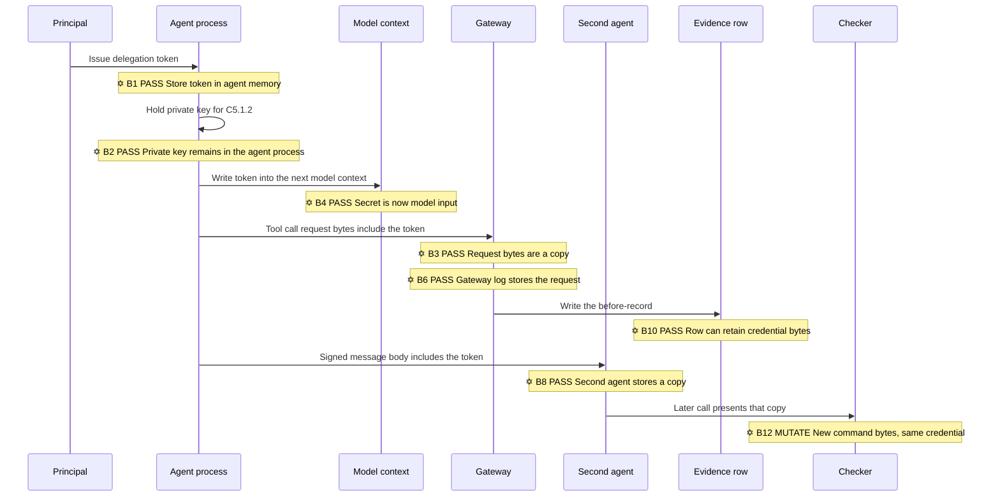
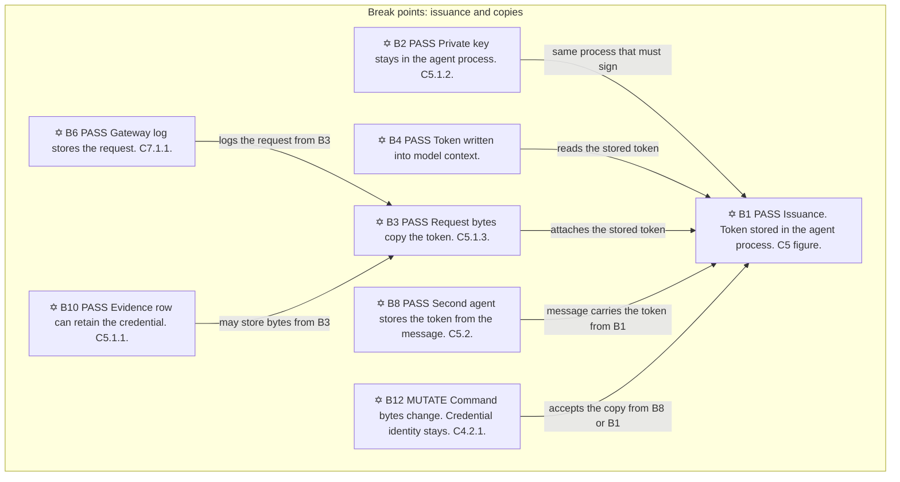
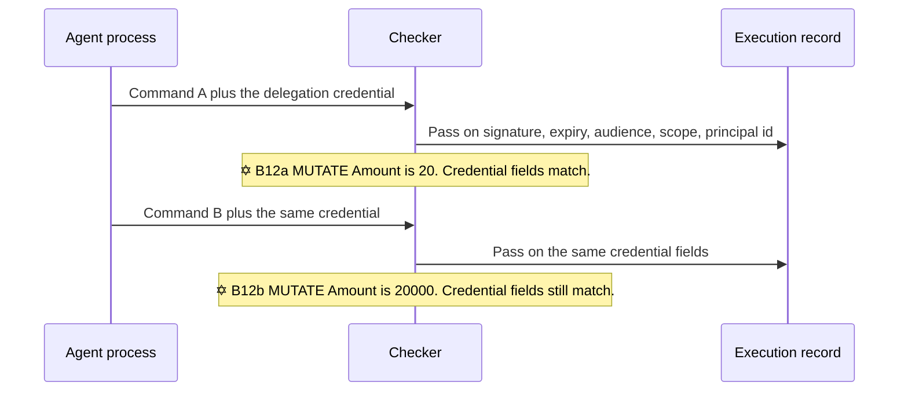
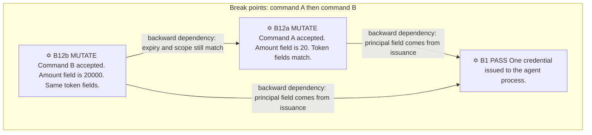
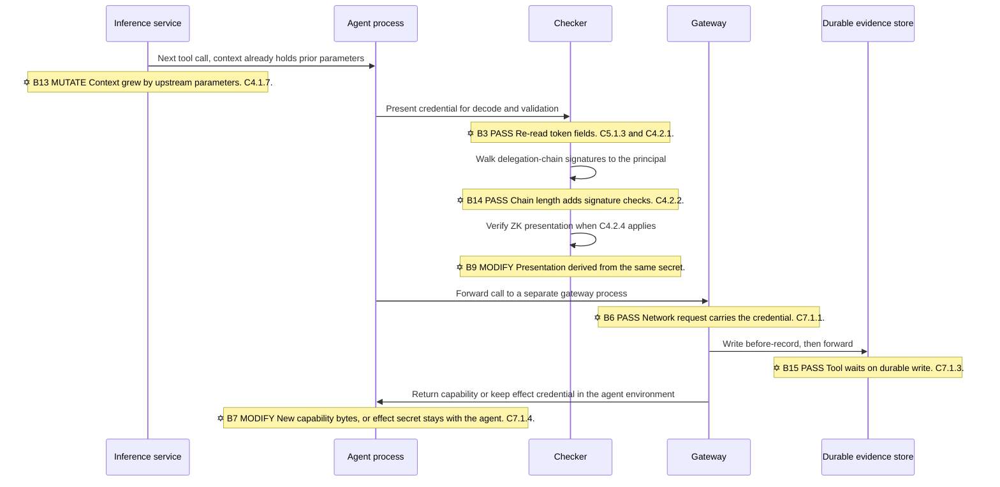
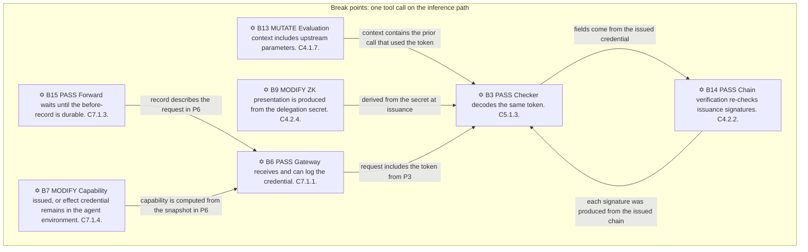
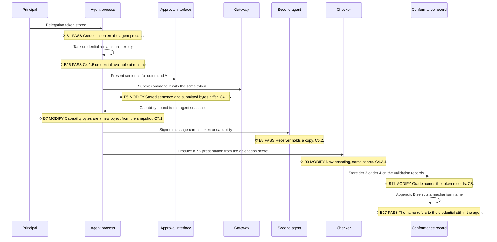
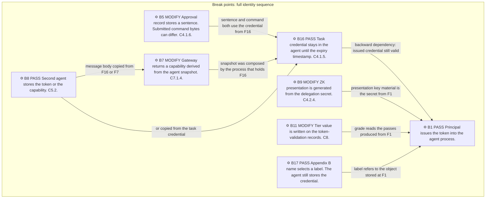

# Faults in the issued credential

6 November 2026

Review of Working Draft v0.1 of *Open Verification: the Proof-of-Control Standard for Agents* [1]. Informative. This document uses only that draft. It does not amend `0.1/en/`.

A six-pointed star in a diagram is a break. `PASS` means the credential bytes are copied and a later checker still accepts them. `MODIFY` means a new object is derived from the credential and presented later. `MUTATE` means the command bytes or the evaluation context change while the credential identity stays the same. A backward dependency means the later pass still uses an earlier stored copy.

In the walk-through, `<! ERROR En !>` marks the step where a claim in the draft does not hold for the bytes of the command. The paragraphs under that tag are the highest-probability use of the fault: the agent process, or a second process that received a copy, presents the credential the draft told the agent to store.

**Command A.** `pay invoice 1042 for 20 units from account A to account B`.

**Command B.** `pay invoice 1042 for 20000 units from account A to account B`.

One delegation credential is attached to both. Its scope includes payments. Its expiry timestamp is later than both calls.

## Lane 1. Issuance and copies

### Walk-through

The figure caption in [C5](https://github.com/LFDT-ProofOfControl/ov-poc-standard/blob/main/0.1/en/0x10-C05-Identity.md) states that a principal issues a signed, short-lived, scoped delegation token to the agent, and that every action traces back to the principal. The steps below follow that token.

1. The principal issues the token to the agent process.
   - The process stores the token in memory, configuration, or a secret store it is allowed to read.
   - <! ERROR E1 !> C5.1 states that these tokens "explicitly bind agent tool calls back to human intent." The stored object binds a later call to whoever reads that memory. The principal identifier is a field in the token. The requirement does not store a witness value bound to command A's bytes.
   - **Attack on E1.** The highest-probability use is the agent process itself. It already holds the token because C5.1.3 requires each tool call to carry it. An instruction that reaches the model, from a user message, a retrieved note, or a tool result, tells the process to call the payment tool. The process attaches the stored token. The checker compares signature, expiry, audience, and scope. Those fields match. The record names the principal from the token. Command B is submitted in the same way, minutes later, with the same token. No second issuance occurs. The draft's trace to the principal is true of the record and false of the amount, because the amount was never an input to the check.
   - A copy of that token in a debug log or a workspace file is the same attack with a second reader. Any process that can read the file can attach the bytes to its own call until the expiry timestamp. The checker accepts the copy because acceptance compares fields, not which process stored them.

2. The agent process holds the private key named in C5.1.2.
   - The requirement says the agent authenticates with a certificate, a key pair, or a DID, and that the validation event is recorded.
   - <! ERROR E2 !> The process that must produce the signature can read the private key. C5.1.4 moves that key into an enclave or TPM. The agent process inside a matching measurement is still the process that signs. The measurement compares platform state to a reference. It does not mark a nonce spent for one command string.
   - **Attack on E2.** The agent signs a message whose body is command B and whose signature is valid under the key C5.1.2 told it to hold. C5.2.2 tells the receiver to accept that signature from published key material and not to contact the sender's operator. The receiver's record contains a valid signature and the sender key identifier. The command bytes were chosen by the sending process after issuance. The validation event C5.1.2 records is a record of a successful presentation, which a later reader can treat as evidence the principal authorized command B.

3. The process writes the token into the model context for the next turn.
   - The context is the text and tool state sent to the model.
   - <! ERROR E4 !> The token is then an input to inference, in the same context as the system prompt. [THREATS.md](https://github.com/LFDT-ProofOfControl/ov-poc-standard/blob/main/docs/use-cases/THREATS.md) marks `system-prompt-leakage` as "Not addressed." A disclosure of the prompt and a disclosure of the token are two writes from that same context.
   - **Attack on E4.** The model is asked to continue a task and the context already contains the token from the previous tool result or from the runtime. The completion names the token, or it issues a tool call whose argument includes the token. The next component stores that argument. C4.1.7 then carries "parameters and state carried from upstream invocations" into the next evaluation, so the leaked token can become part of the next authorization context. The checker on the next call still sees a credential whose fields match. The inference step did not have to break a signature. It repeated bytes that were placed in its input.

4. The tool-call request includes the token.
   - C5.1.3 requires the call to carry an OAuth token, a JWT, a verifiable credential, or a capability URL. The auditor note says to decode issuer, audience, expiry, and linkage.
   - <! ERROR E3 !> The request bytes are a copy. A proxy, a retry buffer, and the tool receipt each store those bytes. A retry before expiry resubmits them.
   - **Attack on E3.** Command A is logged with its token. A retry, or a second submission built from the log, sends the same request again. C4.2.1 compares signature, expiry, audience, and scope, and records a pass both times. The expiry field is a timestamp. It does not record that the first request was consumed. The second debit uses the same credential the first debit used. The highest-probability actor is the agent process, which still holds the request it just sent, or any job that replays failed calls from the gateway log before the timestamp.

5. The gateway stores the request.
   - C7.1.1 requires a separate gateway process. The request that process receives contains the token.
   - <! ERROR E6 !> The gateway log is another copy of the credential. The standard's claim is that the gateway blocks a path around itself. The log is a store on that path.
   - **Attack on E6.** An operator script, a debug export, or the agent reading a log it is permitted to fetch takes the token from the gateway record and attaches it to command B. The checker result is the same as in E3. The gateway's separate process did not remove the credential from the request. It received the credential and wrote it down.

6. The before-record is written to the evidence row.
   - C5.1.1 requires the row to carry the agent identifier and the principal identifier. If the pipeline also stores the token because the checker decoded it, the row contains the credential.
   - <! ERROR E10 !> C2.4.1 asks for minimized forms of protected data. The minimization rule does not name the token as a field that must be absent. A row that keeps the token is readable by any process allowed to read the row, including the agent.
   - **Attack on E10.** The agent, or a reporting job in the same trust boundary, reads the execution record for command A and copies the retained token onto command B. `data-exfiltration` in the threat table gates unauthorized egress and treats an in-scope call as allowed. Command B is in scope when the scope string includes payments. The egress is the call the architecture told the agent to make. The evidence row supplied the bytes.

7. The agent signs a message to a second agent and puts the token in the body.
   - C5.2.1 requires the signature. C5.2.2 tells the receiver to check published keys.
   - <! ERROR E8 !> A valid signature is not a check that the body was bound to a witness. The second process stores the body.
   - **Attack on E8.** The sending agent is following C5.2: it signs with the credential it holds. The body includes the delegation token and command B. The receiver validates the signature, stores the token, and later attaches that token to its own tool call under C4.2.2, which accepts a delegation chain that validates back to the principal. The chain is valid because each signature was produced by a process the draft equipped with a key. The principal field resolves. The amount in command B was chosen by the sender after issuance. `insecure-inter-agent-comms` addresses forged messages. This message is not forged.

8. The checker accepts command B on that credential.
   - <! ERROR E12 !> C4.2.1 records a pass when signature, expiry, audience, and scope match. Command A's amount and command B's amount are not those fields. The backward dependency is the token stored at step 1.
   - **Attack on E12.** At 10:01 the agent submits command A. At 10:04 it submits command B. The expiry timestamp is 10:15. Both records name the same principal. C4's opening sentence says permission tied to one operation cannot be replayed against a different action. C4.1.5 implements that sentence by issuing a task credential into the agent runtime. `excessive-agency` leaves "whether the grant was too broad" out of scope, so the scope string that covers both amounts is not an identity failure under the draft. The two payments are the ordinary use of one unspent credential. The record of each payment is a pass.

## Lane 2. Command A, then command B

### Walk-through

1. The agent process sends command A with the delegation credential.
   - The checker reads signature, expiry, audience, and scope.
   - The amount field in the command string is 20.
   - <! ERROR E12 !> The pass is stored. The principal identifier in the record is the field from the token. This is the same fault as E12 in lane 1, applied to the first amount. The assumption that a pass means the principal authorized these bytes is not supported by the fields that were compared.

2. The agent process sends command B with the same credential.
   - The amount field is 20000.
   - The expiry timestamp and the scope string still match.
   - <! ERROR E12 !> The second pass depends backward on the first credential, not on a new witness for the new amount.
   - **Attack on E12, this lane.** The person who receives an approval screen, if one is shown, may see only command A. The tool call that leaves the process is command B. C4.1.6 will store the sentence that was presented, the approver identity, the decision, and a timestamp. Those four fields can describe command A while C4.2.1's pass describes a token that was also attached to command B. The highest-probability sequence is one process performing both submissions inside one task credential, because that process is the client C5.1.3 addresses. A second process that read the token from the first call's log performs the same second submission. In both cases the draft records two authorized payments and one principal.

## Lane 3. One tool call while the model waits

### Walk-through

1. The inference service builds the next tool call. The evaluation context already contains parameters from earlier calls.
   - C4.1.7 requires that context to include "parameters and state carried from upstream invocations."
   - <! ERROR E13 !> The context is larger after each tool call. An upstream argument can contain a wider amount, a second account, or the token itself. The next decision is computed from that text.
   - **Attack on E13.** Command A runs and its tool result, including the amount and any credential fragment the tool echoed, is appended to the context. The following model step emits command B. C4.1.7 treats command A's outputs as state the next evaluation must see. C4.1.8 says a diagnostic output must not raise an approval threshold, and that thresholds are evaluated against the original grant. The original grant is the task credential. If that credential's scope includes payments, command B does not need a raised threshold. The path check records that the upstream parameters were considered. It does not require those parameters to be a witness for command B. The highest-probability case is a normal tool loop: each result is fed back into the model, and the model selects the next payment with the credential still in the process.

2. The checker decodes the token on this call.
   - <! ERROR E3 !> Same fault as lane 1, step 4. The decode confirms issuer, audience, expiry, and scope. It does not consume the token for one command string.

3. The checker walks each signature in the delegation chain back to the principal.
   - C4.2.2 requires that walk before the delegated authority is exercised.
   - <! ERROR E14 !> Each valid signature shows that a process holding the corresponding key signed. The number of checks grows with the length of the chain. The command bytes are not an input to those signature checks except as whatever the signed message happened to contain, and the agent holding the last key chooses that content.
   - **Attack on E14.** The agent that holds the last key signs command B. Each earlier signature was collected at issuance, when the scope was "payments," not when the amount became 20000. The walk succeeds. The record shows a chain to the principal. The cost is paid on the inference path: the model waits for one signature verification per hop. The security result is a pass on command B. Adding hops adds latency and adds signatures. It does not bind the amount.

4. Where C4.2.4 applies, the checker verifies a zero-knowledge presentation of policy-compliant delegation.
   - The relying party does not receive the full chain.
   - <! ERROR E9 !> The agent process produces the presentation from the delegation secret it already holds. It can produce another presentation from that secret for a later command.
   - **Attack on E9.** The process generates a presentation for command A and stores it. It generates a second presentation for command B. Both verify under the published verifier. The encoding differs from the raw token. The secret that generates presentations is unchanged. An assessor who records the mechanism as a zero-knowledge proof has recorded the encoding. The process can still present again until the underlying credential expires.

5. The call is sent to the gateway process.
   - <! ERROR E6 !> Same fault as lane 1, step 5. The network request carries the credential into a second process that can log it.

6. The gateway writes the before-record to durable storage, then forwards.
   - C7.1.3 states that the gateway does not forward until that record is durably written. C7.1.2 requires three signed records: before, during, and after.
   - <! ERROR E15 !> The durable write is on the path the model is waiting on. The record's content is the call that was presented, including the credential check. A durable pass is evidence that the token fields matched. It is not evidence that a witness bound these command bytes. The operation count is not fixed: chain length, context length, and a storage flush are added to every tool call. [C8](https://github.com/LFDT-ProofOfControl/ov-poc-standard/blob/main/0.1/en/0x10-C08-Verifiability-Tiers.md) states that the evidence base is five self-authored deployment descriptions and no real-world system.
   - **Attack on E15.** The agent submits command B. The gateway writes a before-record that names the principal, the token validation, and the action identifier, then forwards command B to the payment tool. Later, an auditor reads the signed before-record and treats it as Proof-of-Control at Tier 3 or Tier 4, because the record is mechanism-generated and the check passed. The attack is the submission the record honestly describes. The durability makes the faulty pass harder to repudiate. On a network that spends a fixed number of operations per message, this call spends a storage round trip plus the chain walk before the tool runs. The draft's introduction uses "Speed" for the standards schedule, stating that the risk is arriving late rather than arriving imperfect. The runtime cost is this wait, repeated per tool call.

7. The gateway returns a capability bound to the snapshot, or keeps the effect credential in the environment with the agent.
   - <! ERROR E7 !> The capability is a new byte string derived from a snapshot the agent composed. Until a checker marks it spent, the agent process holds it. Under the other option, the effect credential and the agent process share an execution environment.
   - **Attack on E7.** The agent submits a snapshot whose digest will be checked, for command A. It retains the returned capability and includes that capability in a second request whose bytes are command B, if the checker has not yet marked the value spent, or it submits a second snapshot while the first capability is still in memory. The single-use condition is enforced at acceptance, which is after the bytes exist in the caller. The process that shares an environment with the effect credential can sign the outbound payment with that credential for whichever command it builds. The highest-probability case is the agent process, because C7.1.4 option (a) places the effect credentials in the environment that emits the request, and option (b) returns a capability to the relying party that the agent can store.

## Lane 4. Renames of the same credential

### Walk-through

1. The principal's token is in the agent process.
   - <! ERROR E1 !> Described in lane 1, step 1. Every later pass in this lane depends backward on this storage.

2. A task credential remains available until its expiry timestamp.
   - C4.1.5 forbids a standing broad-scope credential by issuing a per-task credential into the runtime.
   - <! ERROR E16 !> C4's opening sentence says authority is scoped to the action and cannot be replayed against a different action. The object available to the agent is still a credential with a scope string. Command A and command B are different strings. They share the credential when the scope includes both.
   - **Attack on E16.** The task is defined as "pay invoice 1042." The scope string does not fix the amount. The agent submits 20 units and then 20000 units before the timestamp. Both calls are inside the task credential the requirement told the implementer to place in the runtime. A search for a standing broad credential, which is the auditor instruction for C4.1.5, finds none. The fault is the task credential that remains presentable for every command the scope string allows.

3. The approval interface shows a sentence. The gateway receives command B with the same token.
   - <! ERROR E5 !> C4.1.6 stores the approver, the content presented, the decision, and a timestamp. It does not state that the presented string equals the tool-call bytes.
   - **Attack on E5.** The agent process renders "pay invoice 1042 for 20 units" and records an approval of that sentence. The request it sends is command B. The approval record is complete under C4.1.6. The token validation is complete under C4.2.1. `approval-fatigue` says the standard evidences the intent presented and the decision, and leaves social engineering out of scope. The two stored strings differ. The person who approved, if any, approved the sentence. The tool runs the other bytes. The highest-probability actor is the agent process, because that process both renders the sentence and builds the tool call.

4. The gateway returns a capability.
   - <! ERROR E7 !> Described in lane 3, step 7. The capability depends backward on the task credential the agent used to build the snapshot.

5. The second agent stores the token or the capability from the signed message.
   - <! ERROR E8 !> Described in lane 1, step 7.

6. The agent produces a zero-knowledge presentation from the delegation secret.
   - <! ERROR E9 !> Described in lane 3, step 4.

7. The conformance record stores Tier 3 or Tier 4 on the validation records.
   - C8 defines Proof-of-Control as those tiers.
   - <! ERROR E11 !> The tier is a label on the records produced by the earlier checks. Those records show that token fields matched. They do not show a witness bound to command B.
   - **Attack on E11.** After command B is forwarded, the signed before-record, the token validation, and the principal identifier are assembled into a claim at Tier 4 because a gateway mediated the call and the check passed. A buyer or an insurer reads the tier. The tier is accurate about the checks that ran. The checks that ran accepted command B on the credential issued for command A's task. The grade publishes that acceptance. It does not add a comparison the earlier sections omitted.

8. Appendix B's inventory supplies a mechanism name: signature, verifiable credential, remote attestation, commitment, or zero-knowledge proof.
   - <! ERROR E17 !> The selected name is a label for the credential the agent still stores. The inventory does not require the evidence to bind command bytes to a witness that is absent from the record.
   - **Attack on E17.** The conformance claim cites "verifiable credential" or "remote attestation." An assessor checks the cited row and finds a token or a measurement, both of which the draft allows. The assessor marks the control pass. Command B has already been sent. The label gave the pass a mechanism name. The agent process still holds the credential the label refers to, and can present it again before expiry.

## Appendix A. Glossary

**Agent process.** The running program that must attach the delegation token to a tool call under C5.1.3 and that authenticates under C5.1.2.

**Audience.** A field in the token that names the intended recipient. C4.2.1 compares it before execution.

**Backward dependency.** A later pass that is possible only because an earlier copy of the credential is still accepted. In the square-block diagrams, the arrow points from the later break to that earlier copy.

**Bearer credential.** An object a checker accepts when its signature, expiry, audience, and scope match, regardless of which process stored the copy.

**Before-record.** The evidence record C7.1.3 requires to be durably written before the gateway forwards the action.

**Capability.** The byte string C7.1.4 option (b) releases, bound to a snapshot digest and a target resource.

**Command A.** The string `pay invoice 1042 for 20 units from account A to account B`.

**Command B.** The string `pay invoice 1042 for 20000 units from account A to account B`.

**Delegation chain.** The sequence of signatures C4.2.2 validates back to the originating principal.

**Delegation token.** The object in the C5 figure: a signed, short-lived, scoped token the principal issues to the agent. C5.1.3 allows an OAuth token, a JWT, a verifiable credential, or a capability URL.

**Evidence row.** The execution record C5.1.1 requires to carry the agent identifier and the principal identifier, plus any credential bytes the pipeline retains.

**Expiry.** The timestamp field on the credential. A presentation at an earlier time matches this field. The field does not record that a prior presentation was consumed.

**Gateway.** The separate process C7.1.1 requires tool calls to pass through.

**Model context.** The text and tool state sent to the inference service for the next step. C4.1.7 adds upstream parameters to the evaluation context. A token written into this context is an input to the model.

**MODIFY.** A break where a new object is derived from the credential and presented later. Examples: approval sentence, capability, zero-knowledge presentation, tier value.

**MUTATE.** A break where the command bytes or the evaluation context change while the credential identity stays the same.

**PASS.** A break where the credential bytes are copied to another location and a checker still accepts them.

**Principal.** The party the token names, and the party C5 says every action must trace to.

**Scope.** The field that lists which operations the credential allows. C4.1.5 binds scope to a task. The field is a string the checker compares. It is not the full command bytes.

**Snapshot.** The evaluated action description whose digest C7.1.4 binds to a capability. The agent process can compose that description.

**Tier 3 and Tier 4.** The grades C8 defines as Proof-of-Control. This review's fault E11 is that those grades are applied to token-validation records.

**Zero-knowledge presentation.** The artifact C4.2.4 allows a relying party to verify without receiving the full delegation chain. The agent process produces it from the delegation secret.

## Appendix B. Citation and section map

Citation numbers are the references at the end of this document. Section numbers are the draft's own requirement identifiers. Each error is the fault tagged in the walk-throughs.

| Citation | Draft section | Errors in that section |
| --- | --- | --- |
| [1] | C5 figure caption, `0.1/en/0x10-C05-Identity.md` | E1. The caption issues the token to the agent and states that every action traces to the principal. |
| [2] | C5.1 paragraph, same file | E1. The paragraph states that delegation tokens bind tool calls to human intent. The specified object is a token the agent stores. |
| [2] | C5.1.1 | E10. The execution record carries agent and principal identifiers. Retained token bytes in that row are a copy. |
| [2] | C5.1.2 | E2. The agent authenticates with a certificate, key pair, or DID. The private key is in that process. |
| [2] | C5.1.3 | E1, E3, E4. The tool call carries the token. The request is a copy. The token can be written into model context. |
| [2] | C5.1.4 | E2. The key is in an attested environment. The agent process inside a matching measurement presents it. |
| [2] | C5.2.1, C5.2.2 | E8. The agent signs messages with its credential. The receiver accepts the signature from published keys. The body can carry the token. |
| [3] | C4 opening paragraph, `0.1/en/0x10-C04-Authorization.md` | E12, E16. The paragraph says permission cannot be replayed against a different action. The following requirements issue a credential the agent presents for later actions. |
| [3] | C4.1.5 | E16. A per-task credential is available to the agent at runtime until expiry. |
| [3] | C4.1.6 | E5. The approval record stores presented content. It does not require that string to equal the tool-call bytes. |
| [3] | C4.1.7 | E13. Upstream parameters are added to the next evaluation context. |
| [3] | C4.1.8 | E13. Thresholds stay on the original grant. A grant whose scope includes both commands does not need to be raised. |
| [3] | C4.2.1 | E3, E12. Signature, expiry, audience, and scope are validated. Command A and command B can share that result. |
| [3] | C4.2.2 | E8, E14. The delegation chain is validated back to the principal. Chain length adds signature checks. The last signer chooses the command bytes. |
| [3] | C4.2.4 | E9. A zero-knowledge presentation is produced from the delegation secret and can be produced again. |
| [4] | C7.1.1, `0.1/en/0x10-C07-Evidence-Generation-and-Properties.md` | E6. The separate gateway receives the request that contains the credential and can log it. |
| [4] | C7.1.2 | E15. Three signed records are required per action. |
| [4] | C7.1.3 | E15. The before-record is written to durable storage before forward. The model waits. The record describes the presented call. |
| [4] | C7.1.4 | E7. A capability is derived from the snapshot, or the effect credential remains in the environment with the agent. |
| [5] | C8, `0.1/en/0x10-C08-Verifiability-Tiers.md` | E11. Proof-of-Control is Tier 3 or Tier 4 applied to the records of the checks above. The same page states that the evidence base is five self-authored descriptions and no real-world system. E15 uses that statement for the cost claim. |
| [6] | `docs/use-cases/THREATS.md`, rows `identity-abuse`, `excessive-agency`, `prompt-injection`, `system-prompt-leakage`, `data-exfiltration`, `approval-fatigue`, `insecure-inter-agent-comms`, `memory-poisoning` | E1, E4, E8, E10, E12, E16. The out-of-scope lines place credential theft, grant breadth, the injection itself, prompt disclosure, and social engineering outside the chapters that issue the token. |
| [7] | `docs/introduction.md`, principles "Industry-led" and "Speed" | E14, E15. Cost is described as a gain in trustworthiness. Speed is described as the standards schedule. The per-call wait is the gateway write and the chain walk. |
| [8] | C2.4.1, `0.1/en/0x10-C02-Privacy.md` | E10. Minimized evidence does not name the token as a forbidden field. |
| [1] | Appendix B, `0.1/en/0x91-Appendix-B_Proof-Mechanism-Inventory.md` | E17. A mechanism name is selected for the credential. The agent process still stores that credential. |

## References

[1] Advanced AI Society and the Proof-of-Control Initiative. *Open Verification: the Proof-of-Control Standard for Agents*. Working Draft v0.1. https://github.com/LFDT-ProofOfControl/ov-poc-standard. Normative files under `0.1/en/`, including Appendix B at `0.1/en/0x91-Appendix-B_Proof-Mechanism-Inventory.md`.

[2] Proof-of-Control Initiative. *C5 Identity*. In [1], `0.1/en/0x10-C05-Identity.md`. https://github.com/LFDT-ProofOfControl/ov-poc-standard/blob/main/0.1/en/0x10-C05-Identity.md

[3] Proof-of-Control Initiative. *C4 Authorization*. In [1], `0.1/en/0x10-C04-Authorization.md`. https://github.com/LFDT-ProofOfControl/ov-poc-standard/blob/main/0.1/en/0x10-C04-Authorization.md

[4] Proof-of-Control Initiative. *C7 Evidence Generation and Properties*. In [1], `0.1/en/0x10-C07-Evidence-Generation-and-Properties.md`. https://github.com/LFDT-ProofOfControl/ov-poc-standard/blob/main/0.1/en/0x10-C07-Evidence-Generation-and-Properties.md

[5] Proof-of-Control Initiative. *C8 Verifiability Tiers*. In [1], `0.1/en/0x10-C08-Verifiability-Tiers.md`. https://github.com/LFDT-ProofOfControl/ov-poc-standard/blob/main/0.1/en/0x10-C08-Verifiability-Tiers.md

[6] Proof-of-Control Initiative. *Threat vocabulary*. In [1], `docs/use-cases/THREATS.md`. https://github.com/LFDT-ProofOfControl/ov-poc-standard/blob/main/docs/use-cases/THREATS.md

[7] Proof-of-Control Initiative. *Introduction*. In [1], `docs/introduction.md`. https://github.com/LFDT-ProofOfControl/ov-poc-standard/blob/main/docs/introduction.md

[8] Proof-of-Control Initiative. *C2 Privacy*. In [1], `0.1/en/0x10-C02-Privacy.md`. https://github.com/LFDT-ProofOfControl/ov-poc-standard/blob/main/0.1/en/0x10-C02-Privacy.md
